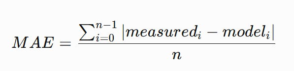

# Programming in Science — Assignment 3

## File I/O, Data Science, and Data Visualization

**Total: 100 marks**  
**Code submission: 40 marks**  
**Post-submission challenge: 60 marks**

## Purpose

In Assignment 3, you will use Python to investigate data stored in CSV files. You will apply file-processing skills from Lecture 9 and plotting techniques from Lecture 10 to complete a small data-science investigation.

The assignment follows the four stages introduced in OpenStax §15.1:

1. **Data acquisition** — obtain data from the supplied CSV files.
2. **Data exploration** — inspect, clean, and visualize the data.
3. **Data analysis** — calculate numerical summaries and identify patterns.
4. **Reporting** — communicate your findings using graphs and a written interpretation.

A graph is not decoration. It should help answer a question about the data. Do not claim that a relationship proves cause and effect.

## General requirements

- Use Python and the supplied CSV files.
- Use Python's built-in `csv` module to read the files.
- Use Matplotlib (`matplotlib.pyplot`) to create the required graphs.
- Use lists, loops, conditionals, functions, and column indexes to process the data.
- Do **not** use Pandas or NumPy for this assignment.
- Do **not** use dictionaries as data containers.
- Do not manually type the dataset values into your program. Read them from the CSV files.
- Convert CSV strings to `int` or `float` before performing numerical calculations.
- Your program must not modify the supplied CSV files.
- Give every graph a meaningful title and labelled axes. Include units where applicable.
- Save each required graph as a PNG file using `plt.savefig(...)` before `plt.show()`.

## Project setup

Create a project folder named `Assignment3`. Inside it, create a Python file named `assignment3.py` and a folder named `data`.

Download and extract the supplied Assignment 3 data package. Place all four CSV files inside the `data` folder.

Your project must have this structure:

```text
Assignment3/
├── assignment3.py
└── data/
    ├── weather_readings.csv
    ├── study_hours_scores.csv
    ├── weekly_sales.csv
    └── sensor_readings_needs_cleaning.csv
```

Install Matplotlib if it is not already installed:

```bash
python -m pip install matplotlib
```

Run your program from the `Assignment3` folder so that paths such as `data/weather_readings.csv` work correctly.

---

# Code Submission — 40 marks

Submit one working Python program named `assignment3.py`. Organize your code into clearly named functions. Your program must complete all four tasks below.

## Q1 — Read and compare weather measurements (10 marks)

**File:** `data/weather_readings.csv`

The file contains three columns:

- `hour`: hour of the day;
- `measured_temp_c`: measured temperature in degrees Celsius;
- `model_temp_c`: temperature predicted by a model, in degrees Celsius.

Write a function:

```python
def read_weather_data(filename):
    ...
```

The function must:

1. Open the CSV file using `with open(filename, "r", newline="")`.
2. Create a `csv.reader`.
3. Skip the header row.
4. Read the three columns using their correct indexes.
5. Convert the hour to `int` and both temperatures to `float`.
6. Store the columns in three separate lists.
7. Return the three lists.

Use the returned lists to create a line graph showing both measured and model temperatures on the same axes.

Your graph must include:
- a meaningful title;
- x-axis label (`Hour of day`);
- y-axis label (`Temperature (°C)`);
- a legend distinguishing measured and model temperatures;
- a grid.

Save the graph as `weather_comparison.png`.

**Analysis:** Calculate the mean absolute error (MAE) between measured and model temperatures:




Print the MAE with an appropriate label and unit.

## Q2 — Investigate study hours and quiz scores (10 marks)

**File:** `data/study_hours_scores.csv`

The file contains a student ID, study hours, and quiz score.

Write a function:

```python
def read_study_data(filename):
    ...
```

The function must read the CSV file, skip the header, convert study hours and quiz scores to `float`, store them in separate lists, and return those lists.

Create a scatter plot with:
- study hours on the x-axis;
- quiz score (%) on the y-axis;
- a meaningful title;
- labelled axes;
- a grid.

Save the graph as `study_hours_vs_score.png`.

Print:
1. the number of observations;
2. the average quiz score;
3. the highest quiz score;
4. the study hours associated with the highest quiz score.

**Interpretation:** Write 3–4 sentences describing the pattern you observe. State one limitation of this dataset. In particular, explain why an apparent relationship does not prove that study time alone caused a score.

## Q3 — Compare weekly sales (8 marks)

**File:** `data/weekly_sales.csv`

The file contains the day of the week, units sold, and revenue in dollars.

Write a function:

```python
def read_sales_data(filename):
    ...
```

Read the file, skip the header, and store the day names, units sold, and revenue in three separate lists. Convert the numeric columns to the appropriate numeric types.

Create a bar chart showing units sold for each day. Include a title and labelled axes. Save it as `weekly_sales.png`.

Print:
1. total units sold for the week;
2. the day with the highest number of units sold;
3. the day with the lowest number of units sold.

Use list indexes to connect a day name to its corresponding sales value.

## Q4 — Inspect and clean sensor readings (12 marks)

**File:** `data/sensor_readings_needs_cleaning.csv`

This fictional room-temperature sensor file contains:
- a missing temperature;
- a non-numeric entry;
- values that are not plausible for this room-temperature investigation.

Write a function:

```python
def read_and_clean_sensor_data(filename):
    ...
```

The function must:

1. Read the CSV file and skip the header.
2. Read the reading number and temperature text from the correct columns.
3. Detect and report an empty temperature field.
4. Use `try`/`except ValueError` to handle a non-numeric temperature.
5. For this assignment, accept only numeric temperatures from 0°C to 50°C, inclusive.
6. Report values that fall outside this range.
7. Store only accepted reading numbers and temperatures in two separate lists.
8. Return the two lists.

Create a line plot of the accepted temperatures against reading number. Include a meaningful title, labelled axes, markers, and a grid. Save it as `cleaned_sensor_readings.png`.

**Important:** Do not silently remove invalid values. Your program must report why each excluded row was not accepted. The 0°C to 50°C rule is specific to this fictional dataset; it is not a universal rule for all temperature data.

---

## Code submission checklist

Before submitting, verify that:

- [ ] All four CSV files are read by your program.
- [ ] Each required function is implemented and called.
- [ ] CSV headers are skipped.
- [ ] Numeric values are converted before calculations.
- [ ] Missing, non-numeric, and out-of-range sensor values are handled.
- [ ] All four graphs are generated and saved as PNG files.
- [ ] Every graph has a meaningful title and labelled axes.
- [ ] The weather MAE and required numerical summaries are printed.
- [ ] Your study-hours interpretation is included in a separate text file or as a clearly labelled comment in your program.
- [ ] Your code is readable, consistently indented, and uses meaningful variable names.

## Code submission marking guide — 40 marks

| Requirement | Marks |
|---|---:|
| Q1: CSV reading, type conversion, two-series line plot, labels/legend/grid, MAE | 10 |
| Q2: CSV reading, scatter plot, summaries, interpretation and limitation | 10 |
| Q3: CSV reading, bar chart, total and highest/lowest day | 8 |
| Q4: missing/non-numeric/range validation, cleaned lists, line plot | 12 |
| **Total** | **40** |

---

# Post-Submission Challenge — 60 marks

The post-submission challenge takes place after the code submission. You must be able to explain and modify your own program. Your instructor will provide the challenge instructions and any changed data or parameters during the challenge.

The challenge assesses your understanding of the algorithm, not just your ability to reproduce code from memory. You may be asked to explain a change before implementing it.

---

## Submission requirements

Submit the following items:

1. `assignment3.py`
2. The four supplied CSV files inside the `data` folder.
3. The four generated PNG graphs:
   - `weather_comparison.png`
   - `study_hours_vs_score.png`
   - `weekly_sales.png`
   - `cleaned_sensor_readings.png`
4. A short interpretation for Q2 (3–4 sentences).

Compress your `Assignment3` folder into one ZIP file and submit it through the course submission system.

Your program must run from the submitted folder. Test it after extracting your ZIP file to a different folder. Do not submit only screenshots of code or graphs.

## Academic expectations

- You are responsible for understanding every line of the submitted program.
- Be prepared to explain your file paths, CSV column indexes, type conversions, lists, loops, conditions, exception handling, and plotting commands.
- You may consult the lecture notes and OpenStax §15.1 while preparing.
- During the post-submission challenge, you must complete the assigned modification yourself and explain your decisions.

## References

- Lecture 9: *File I/O — Turning a Program Into a Data Processor*.
- Lecture 10: *Plotting Graphs — From CSV Data to Visual Evidence*.
- Das, U., Lawson, A., Mayfield, C., & Norouzi, N. (2024). *Introduction to Python Programming*. OpenStax, §15.1, “Introduction to Data Science.”  
  https://openstax.org/books/introduction-python-programming/pages/15-1-introduction-to-data-science
