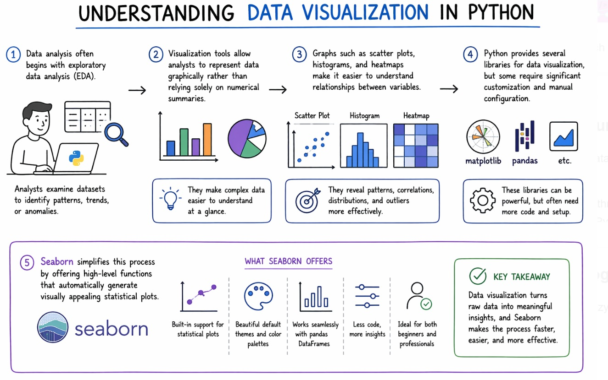
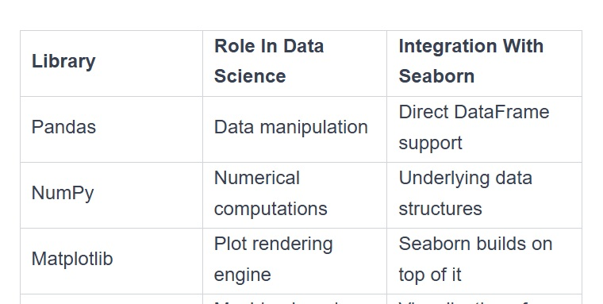

# Lecture 10 Extension: Plotting Graphs --- Seaborn


## 1. Prepare your Python environment

Install Matplotlib:

``` bash
python -m pip install matplotlib
```

For the optional density-plot activity, also install Seaborn:

``` bash
python -m pip install seaborn
```
## What is Seaborn:
Python provides several libraries for data visualization, but some require significant customization and manual configuration. Seaborn simplifies this process by offering high-level functions that automatically generate visually appealing statistical plots.

One of the defining characteristics of seaborn is its ability to work directly with structured datasets such as pandas DataFrames. This integration allows users to generate visualizations without extensive data manipulation.

When learning data visualization with seaborn, it becomes clear that the library focuses heavily on statistical visualization rather than simple plotting. Many of its functions automatically compute statistical relationships and display them visually.

## Key Features Of Seaborn
Seaborn provides a range of features that make it one of the most widely used data visualization tools in the Python ecosystem.

One important feature involves automatic styling and color palettes that produce visually appealing graphs by default. This eliminates the need for extensive customization that is often required when using lower-level visualization libraries.

Another important capability involves statistical plotting functions that visualize distributions, relationships, and categorical comparisons.

Understanding what seaborn is requires recognizing how these features simplify exploratory data analysis and make visual insights easier to discover.

The following table illustrates how seaborn integrates with other Python libraries.


```
https://www.w3schools.com/python/numpy/numpy_random_seaborn.asp

#####################################

import matplotlib.pyplot as plt
import seaborn as sns
sns.set_theme()
# Use sns.load_dataset("name") to load any built‑in Seaborn dataset 
# such as "iris", "tips", or "titanic" into a pandas DataFrame.
print(sns.get_dataset_names())

tips = sns.load_dataset("tips")
print(tips)
sns.relplot(data=tips, x="total_bill", y="tip", hue="smoker", col="time")
plt.show()
```
Import Matplotlib:

``` python
import matplotlib.pyplot as plt
```

### Compare the histogram  
Let's compare the same car-crashes dataset using a histogram in two ways:
- Without Seaborn: Using Matplotlib's plt.hist().
- With Seaborn: Using sns.histplot().
Both examples use the same total column, six bins, and matching axis intervals so students can compare them fairly.

####  Histogram without Seaborn (Matplotlib)
```
import seaborn as sns
import matplotlib.pyplot as plt
from matplotlib.ticker import MultipleLocator

# Load dataset
car_crashes = sns.load_dataset("car_crashes")

# Select numerical column
crash_data = car_crashes["total"]

# Create histogram using Matplotlib
plt.figure(figsize=(9, 5))

plt.hist(
    crash_data,
    bins=6,
    edgecolor="black",
    color="skyblue"
)

plt.title("Distribution of Total Car Crashes - Matplotlib")
plt.xlabel("Total crashes per billion miles")
plt.ylabel("Number of states")

# Set major units
plt.gca().xaxis.set_major_locator(MultipleLocator(2))
plt.gca().yaxis.set_major_locator(MultipleLocator(5))

plt.grid(axis="y", alpha=0.3)
plt.show()
```

What is happening?
- plt.hist() creates the histogram.
- bins=6 divides the data range into six intervals.
- edgecolor makes the boundaries of the bars visible.
- The y-axis displays the number of states in each interval.

#### Histogram with Seaborn
```

import seaborn as sns
import matplotlib.pyplot as plt
from matplotlib.ticker import MultipleLocator

# Load dataset
car_crashes = sns.load_dataset("car_crashes")

# Create histogram using Seaborn
plt.figure(figsize=(9, 5))

sns.histplot(
    data=car_crashes,
    x="total",
    bins=6,
    color="steelblue",
    edgecolor="black"
)

plt.title("Distribution of Total Car Crashes - Seaborn")
plt.xlabel("Total crashes per billion miles")
plt.ylabel("Number of states")

# Set major units
plt.gca().xaxis.set_major_locator(MultipleLocator(2))
plt.gca().yaxis.set_major_locator(MultipleLocator(5))

plt.grid(axis="y", alpha=0.3)
plt.show()

```
#### Compare the two approaches

Matplotlib vs Seaborn
```
Feature	                    Matplotlib	            Seaborn
Function	                plt.hist()	            sns.histplot()
Data input	                Series or array	        DataFrame + column name
Bins	                    bins=6	                bins=6
Axis labels	                Manual	                Manual
Appearance	                More manual control	    Convenient statistical styling
DataFrame integration	Direct Series selection	    Direct column selection
```

## Extension --- Density plot (KDE)

A density plot is a smoothed estimate of a numerical distribution. It is
related to a histogram, but it does not show counts in discrete bins.

Install Seaborn if needed:

```
https://seaborn.pydata.org/generated/seaborn.kdeplot.html

python -m pip install seaborn
```

Then run:

``` python

import seaborn as sns
import matplotlib.pyplot as plt
from matplotlib.ticker import MultipleLocator

# Load sample dataset
car_crashes = sns.load_dataset("car_crashes")

# Display the first five rows
print(car_crashes.head())

# Create KDE plot using one numerical column
plt.figure(figsize=(9, 5))

sns.kdeplot(
    data=car_crashes,
    x="total",
    fill=True,
    color="steelblue"
)

# Add title and axis labels
plt.title("Distribution of Total Car Crashes")
plt.xlabel("Total crashes per billion miles")
plt.ylabel("Estimated density")

# Set major units (tick intervals)
plt.gca().xaxis.set_major_locator(MultipleLocator(2))
plt.gca().yaxis.set_major_locator(MultipleLocator(0.05))

plt.grid(True, alpha=0.3)
plt.show()

```
